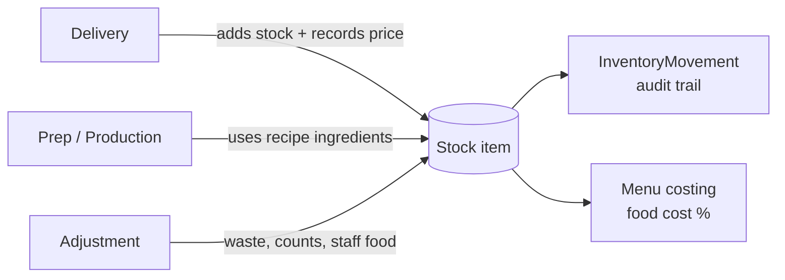

# ChefStock

**Stock management for restaurants, built by a head chef who needed it.**

ChefStock tracks what's in the kitchen, from the delivery coming in the back door to the slice going out the front. It keeps live stock levels and works out the real food cost of every menu item using the prices you actually paid. It can also import sales from Flipdish, the online ordering platform.

I built it because I run a pizza kitchen. I've seen first-hand how much money disappears through waste, out-of-date pricing and guesswork ordering.

<!-- Add a screenshot of the dashboard here, e.g. docs/screenshots/dashboard.png -->


---

## Features

**Stock**
- Stock items with current levels, minimum levels and reorder quantities
- Low-stock list grouped by supplier, so it doubles as an order list
- Deliveries that update stock and record the price paid
- Price history for each item, with a chart of how supplier prices change over time
- Stock adjustments for waste, staff food, damage and stock-count corrections

**Kitchen**
- Recipes for prep items (dough, sauce) and finished dishes
- Prep tasks and production batches that deduct the ingredients they use
- Separate stock units and recipe units: buy cheese by the case, use it by the gram

**Costing**
- Menu items costed from their recipe plus extras (boxes, dips)
- Food cost %, worked out on the price excluding VAT
- Flags any menu item whose cost can't be calculated, e.g. an ingredient with no price yet
- Dashboard with weekly spend, top suppliers and waste

**Teams and restaurants**
- Owner and staff roles, enforced on the backend
- One account can belong to several restaurants
- Staff join a restaurant with an invite code that only the owner can see

**Flipdish integration**
- Imports orders from a Flipdish store
- Matches Flipdish menu items, including sizes like slice / half tray / full tray, to ChefStock menu items

---

## Tech stack

| Layer    | Technology |
|----------|------------|
| Frontend | React 19, Vite, plain CSS, hand-built SVG charts |
| Backend  | Node.js, Express 5 |
| Database | MongoDB with Mongoose |
| Auth     | JWT, passwords hashed with bcrypt |
| External | Flipdish API (OAuth client credentials) |

---

## How stock moves

Every change to stock goes through one of four routes, and each one writes an `InventoryMovement` record.



---

## Design decisions

**An audit trail for every stock change.**
Stock is never edited directly after an item is created. Every change writes an `InventoryMovement` record with the stock level before and after, what caused it and who did it. That gives a full history, and you can always explain why a number is what it is.

**Transactions for multi-step writes.**
A delivery, prep batch, production batch or adjustment can change several stock items and creates a movement record for each one. These writes happen inside a MongoDB transaction, so if one fails they are all rolled back. Stock can't end up half-updated.

**Stock units vs recipe units.**
Kitchens buy in one unit and cook in another: mozzarella comes by the case, but a pizza uses 120 g. Each stock item stores both units and a conversion between them. The app refuses to save an item whose units differ but has no conversion, so costing can't fail later.

**Costing from real prices.**
Each delivery saves the latest price paid on the stock item. A back-dated delivery can't overwrite a newer price. Recipe and menu costs are always based on what you actually paid.

**Data is scoped to a restaurant, and roles are checked on the server.**
Every query is filtered by the current restaurant, and the user's membership is checked on each request. Owner-only actions are blocked by middleware, not just hidden in the UI. Anyone can call an API directly, so hiding a button isn't security.

**Only expected fields are saved.**
Create and update endpoints copy only the fields they expect from the request body. A request can't set things like `restaurant` or `lastUnitCost` itself.

---

## Getting started

### Prerequisites
- Node.js 20 or newer
- A MongoDB database that supports transactions. A free [MongoDB Atlas](https://www.mongodb.com/atlas) cluster works out of the box; a plain local `mongod` needs to run as a replica set.

### 1. Backend

```bash
cd backend
cp .env.example .env    # then fill in MONGO_URI and JWT_SECRET
npm install
npm run dev             # starts the API on http://localhost:5050
```

### 2. Demo data (optional but recommended)

The seed script creates a demo pizza shop with about 10 weeks of history. It simulates the shop day by day (deliveries, prep, production, waste and weekly stock counts), so every page has realistic data.

```bash
cd backend
node scripts/seedDemo.js --add-owner you@example.com
```

Register an account with that email first; `--add-owner` makes it an owner of the demo restaurant. You can run the script again at any time: it only replaces the demo restaurant's data.

### 3. Frontend

```bash
cd frontend
npm install
npm run dev             # opens on http://localhost:5173
```

The frontend expects the API at `http://localhost:5050/api`. To use a different address, set `VITE_API_URL` in `frontend/.env`.

### Environment variables (`backend/.env`)

| Variable | Required | Description |
|----------|----------|-------------|
| `PORT` | No | API port, defaults to 5050 |
| `MONGO_URI` | Yes | MongoDB connection string |
| `JWT_SECRET` | Yes | Any long random string, used to sign login tokens |
| `FLIPDISH_CLIENT_ID` | No | Only needed for the Flipdish integration |
| `FLIPDISH_CLIENT_SECRET` | No | Only needed for the Flipdish integration |

---

## Project structure

```
backend/
  controllers/   request handlers, one file per resource
  models/        Mongoose schemas
  routes/        Express routers
  middleware/    auth, restaurant access and owner-only checks
  services/      Flipdish API client and order import
  utils/         unit conversion and cost calculations
  scripts/       demo data seeding and one-off data migrations
frontend/src/
  pages/         one folder or Page/View pair per screen
  forms/         create/edit forms
  components/    shared UI (layout, tables, charts)
  hooks/         useApi, useSubmit, useTableControls
  context/       logged-in user and current restaurant
```

---

## Roadmap

- [ ] Stock Adjustments page (adjustments can currently be made from a stock item's detail page)
- [ ] Deduct stock automatically from Flipdish sales, using each menu item's recipe
- [ ] Automated tests and CI
- [ ] Live demo deployment

---

## About

Built by Kacper Wojnarowski, a head chef/manager moving into software engineering.
[GitHub](https://github.com/Wojnarrr)
